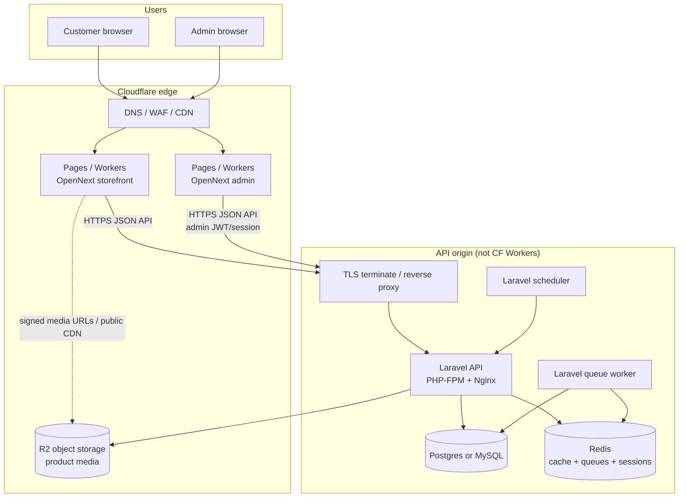
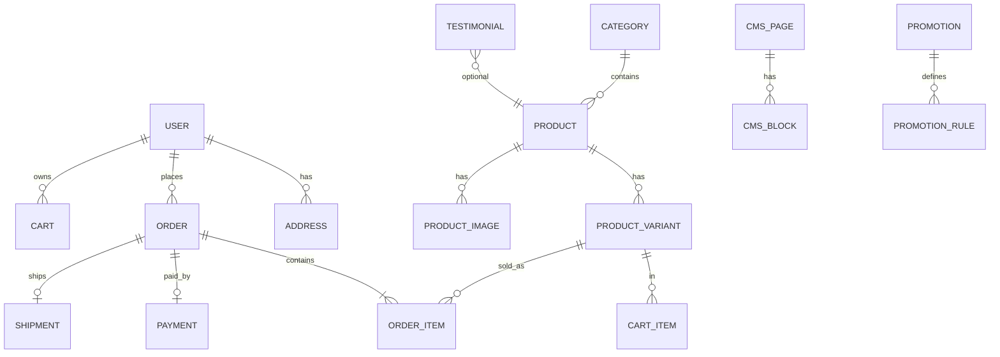

# Kayamrut Farms — Architecture & Implementation Plan

**Status:** Planning deliverable (no app code yet)  
**Repo:** https://github.com/niketanbothe01/Kayamrut-Farms  
**Local:** `/Users/niketan.bothe/work/personal/Kayamrut-Farms`  
**References:** Praakritik storefront IA (high-level), Instagram/brand notes, local PDS + frontend patterns (structure only)

---

## 1. Goals

Build a greenfield organic-superfoods ecommerce platform for **Kayamrut Farms™**:

| App | Role | Stack |
| --- | --- | --- |
| **Storefront** (`frontend/`) | Browse, PDP, cart, checkout, account | Next.js + React |
| **Admin** (`admin/`) | Catalog, orders, content, promotions | Next.js + React *(default recommendation; see open decisions)* |
| **API** (`backend/`) | Catalog, cart/orders, auth, CMS, payments webhooks | **Laravel** |

**DX requirement:** one command boots the full stack via Docker Compose.  
**Deploy end-state:** Cloudflare at the edge for the Next apps; Laravel + DB + Redis on practical compute (hybrid). Be honest: classic Laravel does not run as a Cloudflare Worker.

**Product bar (Praakritik-like, not a clone):** category browse, product cards with size variants + quick add, sale badges / sold-out notify, trust storytelling (Bilona / farm process), cart → checkout → order confirmation. Brand catalog focuses on A2 ghee, cold-pressed oils, powders, seeds, makhana (+ later protein / boxes).

---

## 2. High-level architecture



### Runtime honesty (Laravel × Cloudflare)

| Piece | Cloudflare-native? | Recommendation |
| --- | --- | --- |
| Next storefront / admin | Yes — **Pages + Workers** via OpenNext / `@opennextjs/cloudflare` | Primary UI hosting |
| Static assets + images | Yes — **R2** (+ optional Images) | Product images, CMS media |
| DNS, TLS, WAF, caching | Yes | Front everything |
| Laravel (PHP), migrations, Eloquent, Horizon-style workers | **No** on Workers today (no durable PHP runtime; Containers exist but are early/ops-heavy) | Run Laravel on **Fly.io, Railway, Render, or a small VPS**; put Cloudflare proxy in front |
| MySQL / Postgres | Not on CF | Managed DB next to Laravel (Fly Postgres, Railway, RDS, etc.) |
| Redis | Not on CF | Same provider as API or Upstash only if Laravel client is compatible for cache/queues |

**Default deploy topology:** hybrid Cloudflare (UI + media + edge) + one small Laravel origin region (India-friendly latency if customers are primarily IN).

---

## 3. Monorepo layout

Keep the existing three top-level apps. Do **not** fold admin into `frontend/` for v1 — separate deployable, separate auth cookies, smaller blast radius (matches scaffold + Praakritik-style ops: shop vs backoffice).

```text
Kayamrut-Farms/
├── README.md
├── docs/
│   └── architecture-plan.md          # this file
├── docker-compose.yml                # one-command local stack
├── Makefile  or  scripts/dev.sh      # thin wrappers
├── .env.example                      # root compose vars
├── backend/                          # Laravel API
│   ├── app/  Modules?/  routes/  database/  ...
│   ├── Dockerfile
│   └── .env.example
├── frontend/                         # Next.js storefront
│   ├── src/app  src/features  src/shared
│   ├── Dockerfile.dev  Dockerfile
│   └── .env.example
└── admin/                            # Next.js admin (or Filament later)
    ├── src/app  src/features  src/shared
    ├── Dockerfile.dev  Dockerfile
    └── .env.example
```

**Local URLs (proposed):**

| Service | URL |
| --- | --- |
| Storefront | http://localhost:3000 |
| Admin | http://localhost:3001 |
| API | http://localhost:8080 |
| Mailpit (dev mail) | http://localhost:8025 |
| MinIO console (dev S3) | http://localhost:9001 |

---

## 4. Domain model sketch

Aligned to Kayamrut catalog + Praakritik-style shopping (variants, promotions, sold-out).



### Core entities

| Entity | Notes |
| --- | --- |
| **Category** | Matches brand IA: Cold Pressed, A2 Ghee, Seeds, Organic Powders, Makhana, Promotions; nested optional |
| **Product** | Name, slug, description, SEO fields, status (`draft`/`active`/`archived`), badges (`bestseller`, `coming_soon`) |
| **ProductVariant** | Size/pack (500 ml, 1 L, 100 g…), SKU, price, compare-at, stock, weight for shipping |
| **ProductImage** | R2 key, alt, sort; primary flag |
| **Cart / CartItem** | Guest cart via signed cookie or UUID; merge on login |
| **Order / OrderItem** | Snapshot price/title/SKU; status: `pending` → `paid` → `processing` → `shipped` → `delivered` / `cancelled` |
| **Payment** | Provider ref (Razorpay recommended for IN), amount, status |
| **Shipment** | Carrier, AWB, tracking URL |
| **User** | Customer accounts; separate **AdminUser** or role flag with hard gate |
| **Address** | Shipping/billing |
| **Promotion** | % off, BOGO later; keep MVP to percentage / flat coupon |
| **CmsPage / CmsBlock** | Home hero, Bilona story, About, FAQ |
| **Testimonial** | Quote, attribution, optional product link (IG highlight signal) |
| **InventoryMovement** | Optional MVP+; at least stock integer on variant for sold-out / notify |

### Catalog seed (MVP)

Ghee (A2 Gir), cold-pressed sunflower + coconut oils, moringa / ashwagandha / shatavari / brahmi powders, makhana, pumpkin + watermelon seeds. Mark neem, spirulina, flax, chia, Shilajit, protein, fruit boxes as **coming soon** CMS or product status.

---

## 5. Auth model

| Actor | Mechanism | Notes |
| --- | --- | --- |
| **Customer** | Laravel Sanctum (SPA cookie or token) | Email/password MVP; Google OAuth optional later; guest checkout allowed |
| **Admin** | Separate Sanctum guard / `admin` ability | No shared “is_admin” cookie with storefront origin if possible — different subdomain (`admin.` vs `www.`) |
| **API** | Stateless JSON + CSRF for cookie SPA, or Bearer for admin | CORS allowlist for local + CF domains |

**Patterns borrowed from PDS (shape only):** route/middleware guards, dedicated admin surface, API-first resources — **not** Passport multi-tenant rental domain logic.  
**Patterns borrowed from frontend:** `(auth)` route group, feature-local auth UI, shared API client — **not** Rentalmatics permissions/maps.

---

## 6. Docker one-command DX

Inspired by local **frontend** (`docker compose watch`, Docker-only Node) and **rentalmatics-dev-env** (compose multi-service: API + MySQL + companion apps) — simplified for a personal monorepo.

```bash
cp .env.example .env
./scripts/dev up          # or: make up  →  docker compose up --build
```

**Compose services:**

| Service | Image role |
| --- | --- |
| `frontend` | Next dev (watch/sync like FE repo) |
| `admin` | Next dev |
| `api` | PHP 8.3-FPM + Nginx (or `laravel.php` octane later) |
| `queue` | `php artisan queue:work` |
| `db` | Postgres 16 **or** MySQL 8 *(open decision)* |
| `redis` | Redis 7 |
| `mailpit` | Dev SMTP |
| `minio` | S3-compatible local stand-in for R2 |

**Scripts:** `up`, `down`, `logs`, `migrate`, `seed`, `artisan`, `test`. First boot runs migrations + catalog seed.

---

## 7. Cloudflare deploy path

### Recommended hybrid

```text
Customer → Cloudflare (Pages storefront)
Admin    → Cloudflare (Pages admin)
API      → api.kayamrutfarms.com → Cloudflare proxy → Fly.io/Railway/VPS (Laravel)
Media    → media.kayamrutfarms.com → R2
DB/Redis → same region as Laravel origin
```

### Build/deploy matrix

| App | Build | Deploy target |
| --- | --- | --- |
| `frontend` | `next build` via OpenNext Cloudflare adapter | Cloudflare Pages project `kayamrut-storefront` |
| `admin` | same | Cloudflare Pages project `kayamrut-admin` |
| `backend` | Docker image | Fly.io / Railway / Render / Docker VPS |
| Media | upload via API | Cloudflare R2 |
| Secrets | CF secrets + origin env | Never commit |

### What Cloudflare alone cannot replace (today)

- Full Laravel + Eloquent + queue workers as a drop-in Worker  
- Managed relational DB inside CF  

If the user later insists on “all Cloudflare,” options are: (a) rewrite API to Hono/Workers + D1/Turso (**rejects Laravel constraint**), or (b) wait on / invest in **Cloudflare Containers** for the Laravel image (possible, less mature DX). Plan assumes **hybrid**.

### Payments / India

MVP checkout: **Razorpay** (orders API + webhook → Laravel). Ship INR pricing, GST fields on invoices as polish phase.

---

## 8. Storefront IA (Praakritik skim → Kayamrut)

High-level flows to implement (not pixel-perfect):

1. **Home** — hero, featured categories, bestsellers, process/trust strip (Bilona / cold-press / pure), testimonials  
2. **Shop / Category** — grid, badges (sale, sold out), variant size on card, **Add** steppers  
3. **PDP** — gallery, variant picker, benefits/story, related products  
4. **Cart drawer / page** → **Checkout** (address, shipping, pay) → **Order confirmation**  
5. **Account** — orders, addresses (post-MVP ok to stub)  
6. **CMS** — About, process stories, FAQ, contact/WhatsApp  
7. **Sold out** — notify-me capture  

Nav mirrors IG highlights: Shop by **Ghee / Oils / Powders / Seeds / Makhana**, plus About & Account.

---

## 9. Phased build order

### Phase 0 — Foundation (week-zero engineering)

- Root Compose + Makefiles/scripts  
- Laravel app skeleton in `backend/` (Sanctum, modules or domain folders, healthcheck)  
- Next storefront + admin skeletons (App Router, shared UI tokens)  
- CI: lint/typecheck/phpunit smoke  
- Seed categories + 8–12 products  

### Phase 1 — MVP commerce

- Catalog APIs + storefront browse/PDP  
- Cart + checkout + Razorpay test mode  
- Order admin list/detail + status updates  
- Basic CMS home blocks  
- R2/MinIO image upload from admin  

### Phase 2 — Polish

- Coupons, bestsellers badges, notify-me  
- Customer accounts + order history  
- Emails (order confirmation) via queue  
- SEO (slugs, meta, sitemap)  
- Testimonials module  

### Phase 3 — Deploy

- OpenNext → Cloudflare Pages (preview + prod)  
- Laravel origin + managed DB/Redis  
- Custom domains, WAF, backups, error tracking  
- Production Razorpay + shipping workflow  

**Out of scope for early phases:** subscriptions/fruit boxes, full OMS, multi-warehouse, app native clients.

---

## 10. What we borrow from PDS / frontend (patterns only)

### From `~/work/git/platform-data-service` (Laravel)

| Borrow | Do not copy |
| --- | --- |
| Modular folder thinking (`Http` / `Services` / `Repositories` / `Routes` / `Tests` per domain) | Rental/tenant/fleet domain entities & business rules |
| Explicit artisan DX (`migrate`, analysis, tests) | Nova licensing, Bigtable, Firestore, multi-tenant migration commands |
| API-first JSON resources + Form requests | Passport-heavy multi-guard rental auth graph |
| Queue workers beside the API container | Horizon/GCP-specific infra as a hard dependency for MVP |
| Health check endpoint habit | Proprietary modules |

Prefer **Laravel 11/12** modular domains (`app/Domain/Catalog`, `…/Orders`, …) or lightweight `nwidart/laravel-modules` **without** porting PDS modules.

### From `~/work/git/frontend` (Next.js)

| Borrow | Do not copy |
| --- | --- |
| Docker-only DX (`Dockerfile.dev`, `compose watch`, cache volume) | Rentalmatics product features, maps, Redux fleet state |
| `src/app` route groups + `src/features/*` + `src/shared/*` | Internal API shape assumptions / generated rental types |
| `.env.example` + `.env.local` precedence | Tenant hosting model |
| validate scripts (typecheck/lint/test) culture | MUI-heavy dashboard chrome (storefront should feel brand-first, not admin-dash) |
| AGENTS.md / Next docs discipline | Proprietary e2e personas |

Admin UI may use denser components; **storefront** should follow brand visual rules (earthy, not purple SaaS).

### From `rentalmatics-dev-env` / `platform-admin`

| Borrow | Do not copy |
| --- | --- |
| Multi-service Compose (api + db + redis + sibling UIs) | Internal hostnames, Nova-as-default requirement |
| Idea of separate admin deployable | Any rental admin screens |

---

## 11. Open decisions (need user input)

1. **Database:** Postgres 16 (recommended greenfield) vs MySQL 8 (closer to PDS muscle memory)?  
2. **Admin implementation:**  
   - **A (recommended):** separate Next.js `admin/` talking to Laravel JSON API (CF Pages-friendly, matches scaffold)  
   - **B:** Laravel **Filament** (or Nova) served from `backend` — faster CRUD MVP, weaker CF Pages story for admin  
3. **Hosting for Laravel:** Fly.io vs Railway vs Render vs existing VPS — pick one for Phase 3.  
4. **Cloudflare purity:** confirm hybrid is OK (UI on CF, API off-CF).  
5. **Payments:** Razorpay default for India — confirm.  
6. **Guest checkout:** allow without account? (recommended: yes)  
7. **Domain:** use `kayamrutfarms.com` when DNS is controllable; until then CF preview URLs.  

---

## 12. Success criteria for “ready to code”

- [ ] Open decisions 1–4 answered  
- [ ] This plan accepted  
- [ ] Phase 0 Compose boots on Nick’s Mac with empty-ish but routable apps  
- [ ] No proprietary PDS/frontend business logic in the new repo  

---

*Document generated as a planning deliverable. Implementation starts only after plan approval.*
